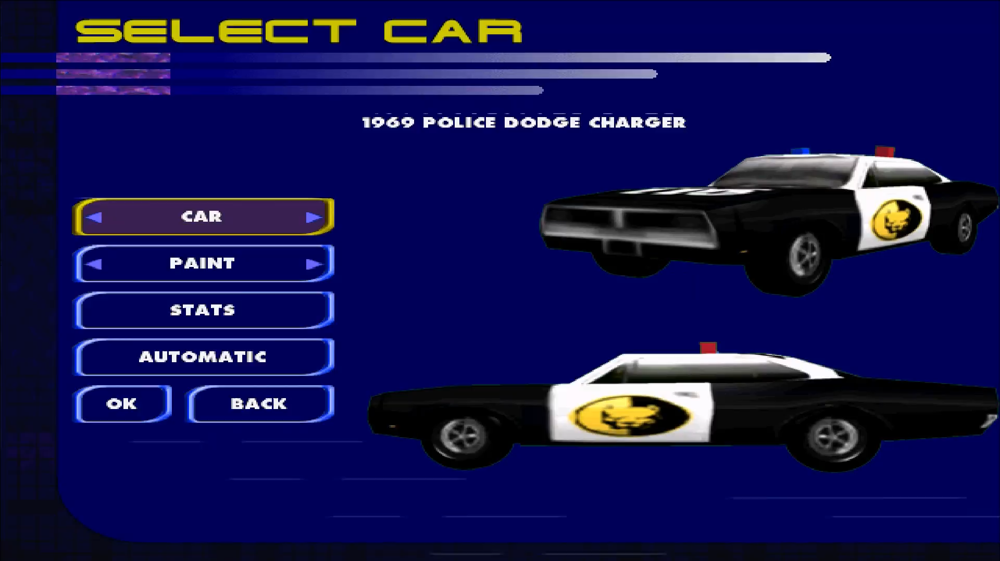

# Test Drive 5 Mod Loader

A lightweight mod loader for **Test Drive 5 (PC)** that makes installing and managing additional cars easier.

Add new cars to the game without manually replacing the original files. Map support is currently a work in progress.


> [!IMPORTANT]
> **Get the latest verion:** Download the mod loader from the [Releases]() page.
## FEATURES

- **Additional Cars** — Add up to 128 cars to the game.
- **ZIP Support** — Install car addons using ZIP archives.
- **Organized Structure** — Keep your addons neatly organized in dedicated folders.
- **Map Support** — Map addon support is currently a work in progress.

## DEMONSTRATION


### VIDEO

[](docs/media/showcase.mp4)

*Click the preview to watch the video demonstration.*

## INSTALLATION

1. Open your main **Test Drive 5** installation directory — the folder containing `TD5_d3d.exe` and `VOODOO2.exe`.
2. Create a folder named `scripts`.
3. Create another folder named `mods`.
4. Place `td5mods.asi` inside the `scripts` folder.
5. Place `mods.ini` inside the `mods` folder.
6. Place `dsound.dll` in the main game directory, alongside the game executables.
7. Inside `mods`, create a folder named `cars`.
8. Place your car addon ZIP archives inside `mods/cars`.
9. Place your level addon ZIP archives directly inside `mods`.
10. Launch the game.

### EXPECTED DIRECTORY STRUCTURE

```text
Test Drive 5/
│
├── TD5_d3d.exe
├── VOODOO2.exe
├── dsound.dll
│
├── scripts/
│   └── td5mods.asi
│
└── mods/
    ├── mods.ini
    │
    ├── cars/
    │   ├── car-addon-01.zip
    │   ├── car-addon-02.zip
    │   └── car-addon-03.zip
    │
    └── level-addon.zip
```

## REQUIREMENTS

- An original copy of **Test Drive 5 for PC**.
- Game patched to version **1.1**.

## CREDITS

**Mod Loader**  
Mr_TNT9030

**Ultimate ASI Loader**  
[ThirteenAG](https://github.com/ThirteenAG)

**Original Game**  
The Pitbull Syndicate

### SPECIAL THANKS

A special thanks to the following people for their contributions, support, and help:

- **@Allef** (aka @dragonfoorcee)
- **@Mra_Gaming**
- **@Tropixx_XLR**
- **@AgentBlackDog**

## LICENSE

This project is licensed under the **MIT License**. See the [LICENSE](LICENSE) file for the full license text.

The MIT License applies to the original code of this project only. Test Drive 5, its assets, and third-party components remain the property of their respective owners.

